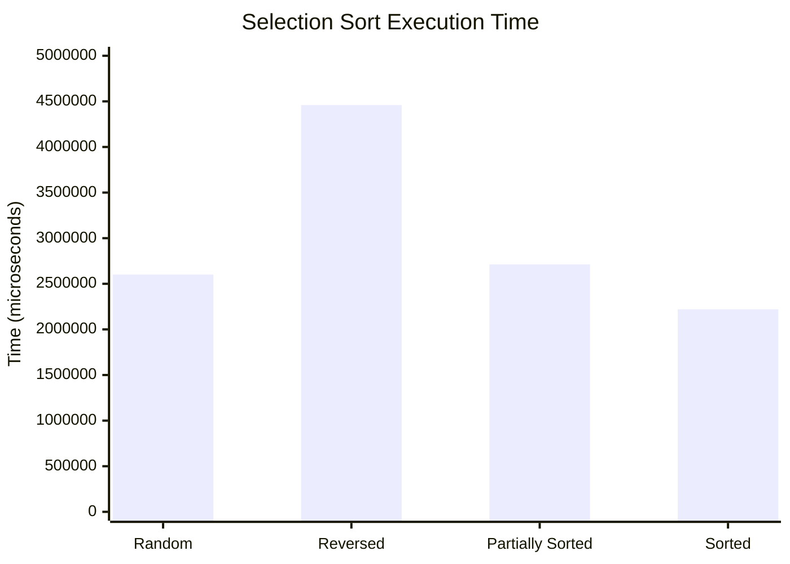

# تقرير تحليل أداء خوارزمية Selection Sort

**المادة:** هياكل البيانات والخوارزميات (Data Structures & Algorithms)

## بيانات الطالب

| البيان | التفاصيل |
|---|---|
| اسم الطالب | جمال عبدالناصر شلابي |
| رقم القيد | 3169116 |
| رقم الشعبة | B |

## نتائج اختبار Selection Sort

**حجم المصفوفة:** N = 100,000 عنصر

**وحدة القياس:** ميكروثانية (µs)

| السيناريو | نوع المصفوفة | زمن التنفيذ (µs) |
|---|---|---:|
| 1 | غير مرتبة (Random) | 2,601,321 |
| 2 | مرتبة عكسيًا (Reversed) | 4,459,458 |
| 3 | مرتبة جزئيًا (Partially Sorted) | 2,712,695 |
| 4 | مرتبة تمامًا (Sorted) | 2,220,304 |

## الرسم البياني للمقارنة

يوضح الرسم التالي زمن تنفيذ Selection Sort في الحالات الأربع:

## تحليل النتائج

- **Random:** استغرق الترتيب 2,601,321 ميكروثانية.
- **Reversed:** استغرق الترتيب 4,459,458 ميكروثانية، وهي أعلى نتيجة في الجدول.
- **Partially Sorted:** استغرق الترتيب 2,712,695 ميكروثانية.
- **Sorted:** استغرق الترتيب 2,220,304 ميكروثانية، وهي أقل نتيجة في الجدول.

## التعقيد الزمني والمكاني

- **أفضل حالة:** O(N²)
- **متوسط الحالة:** O(N²)
- **أسوأ حالة:** O(N²)
- **التعقيد المكاني الإضافي:** O(1)

## الخلاصة

توضح النتائج أن Selection Sort تنفذ عددًا كبيرًا من المقارنات حتى عندما تكون المصفوفة مرتبة مسبقًا، لأن الخوارزمية تبحث عن أصغر عنصر في الجزء المتبقي في كل دورة.

لهذا السبب، لا تُعد Selection Sort الخيار الأفضل للمصفوفات الكبيرة التي تحتوي على 100,000 عنصر، مقارنة بخوارزميات مثل Merge Sort التي تتميز بتعقيد زمني O(N log N).
